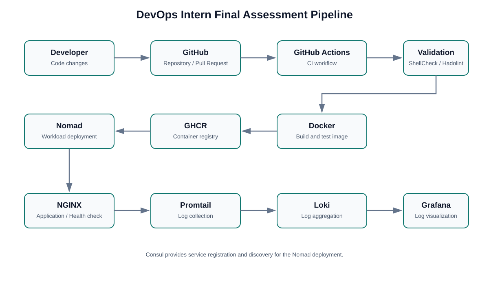
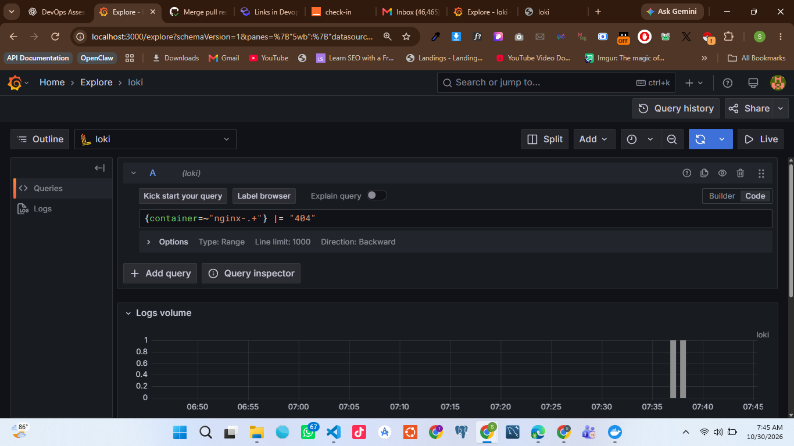
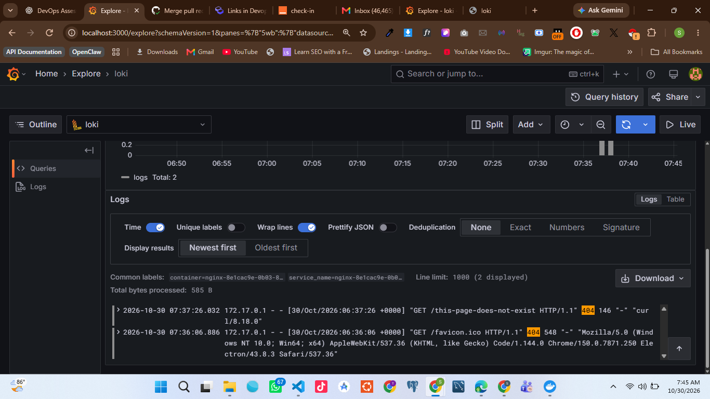
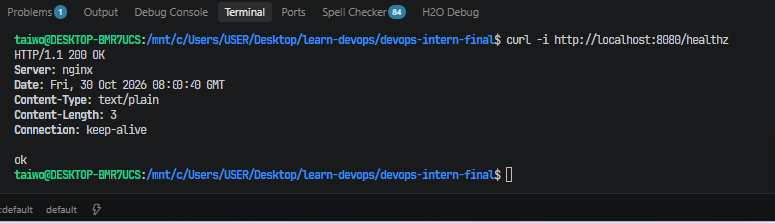

# DevOps Intern Final Assessment — NGINX Deployment Pipeline


A containerized NGINX web application demonstrating Linux administration, Bash scripting, Docker, Git/GitHub collaboration, continuous integration and delivery, Nomad deployment, and centralized logging with Loki, Promtail, and Grafana.

**Author:** Taiwo Shobo  
**Assessment date:** 30 October 2026
**Repository:** [Taiwo17/devops-intern-final](https://github.com/Taiwo17/devops-intern-final)

---

## Table of Contents

1. [Project Overview](#1-project-overview)
2. [Repository Structure](#2-repository-structure)
3. [Prerequisites](#3-prerequisites)
4. [Task 1 — Repository Setup and Git Workflow](#4-task-1--repository-setup-and-git-workflow)
5. [Task 2 — Bash Automation Scripts](#5-task-2--bash-automation-scripts)
6. [Task 3 — Docker Containerization](#6-task-3--docker-containerization)
7. [Task 4 — GitHub Actions CI/CD](#7-task-4--github-actions-cicd)
8. [Task 5 — Nomad Deployment](#8-task-5--nomad-deployment)
9. [Task 6 — Centralized Logging and Monitoring](#9-task-6--centralized-logging-and-monitoring)
10. [Architecture](#10-architecture)
11. [Quick Start](#11-quick-start)
12. [Testing and Validation](#12-testing-and-validation)
13. [Screenshots and Evidence](#13-screenshots-and-evidence)
14. [Troubleshooting](#14-troubleshooting)
15. [Limitations and Future Improvements](#15-limitations-and-future-improvements)
16. [Assessment Status](#16-assessment-status)

---

## 1. Project Overview

The objective of this project is to build and document an end-to-end deployment pipeline for a lightweight NGINX web application.

The project combines Linux command-line administration, automated health checks, container security, Git-based version control, CI/CD, workload orchestration, and centralized log analysis.

### Objectives

- Create a public GitHub repository with a clear project structure.
- Implement reusable Bash scripts for system information and application health checks.
- Package an NGINX application into a lightweight, non-root Docker container.
- Expose the application on port `8080` and provide a `/healthz` endpoint.
- Embed a build identifier in the application.
- Automate linting, building, testing, and publishing through GitHub Actions.
- Define and deploy an NGINX workload using HashiCorp Nomad.
- Collect and query logs using Loki, Promtail, and Grafana.
- Document implementation decisions, testing evidence, troubleshooting, and limitations.

## 2. Repository Structure

The project uses the following directory structure:

```text
devops-intern-final/
├── README.md
├── .gitignore
├── app/
│   ├── Dockerfile
│   ├── index.html
│   └── nginx.conf
├── scripts/
│   ├── sysinfo.sh
│   └── healthcheck.sh
├── .github/
│   └── workflows/
│       └── ci.yml
├── nomad/
│   └── nginx-app.nomad.hcl
├── monitoring/
│   ├── loki-config.yaml
│   ├── promtail-config.yaml
│   ├── docker-compose.yaml
│   └── loki_setup.md
└── docs/
    └── screenshots/
        ├── grafana-404-logs.png-1.png
        └── grafana-404-logs.png.png
```

The `docs/screenshots/` directory contains assessment evidence, including Grafana log-monitoring results.

## 3. Prerequisites

The following tools are required for the relevant parts of the project.

| Tool            | Purpose                                |
| --------------- | -------------------------------------- |
| Git             | Version control                        |
| GitHub account  | Source code hosting and GitHub Actions |
| Bash            | Automation scripts                     |
| ShellCheck      | Bash script linting                    |
| Hadolint        | Dockerfile linting                     |
| Docker Engine   | Build and run containers               |
| Docker Compose  | Run monitoring services                |
| curl            | HTTP testing                           |
| HashiCorp Nomad | Workload orchestration                 |
| Consul          | Service registration and health checks |
| Loki            | Log aggregation                        |
| Promtail        | Log collection and forwarding          |
| Grafana         | Log exploration and visualization      |

The application and Bash scripts were tested in a WSL 2 Ubuntu environment with Docker available through Docker Desktop.

Check the installed tools:

```bash
git --version
bash --version
docker --version
docker compose version
curl --version
shellcheck --version
```

Check Nomad and Consul when working on the orchestration task:

```bash
nomad version
consul version
```

Install missing tools before running the corresponding task.

## 4. Task 1 — Repository Setup and Git Workflow

### Objective

Create a public GitHub repository, establish the required project structure, and use feature branches for implementation.

### Repository

[Open the GitHub repository](https://github.com/Taiwo17/devops-intern-final)

### Branching strategy

The project uses `main` as its integration branch and feature branches for implementation.

The GitHub Actions implementation was developed on:

```text
feature/github-actions-ci
```

A pull request was opened, reviewed, and merged into `main`.

### Git workflow

The workflow followed for implementation is:

1. Create the repository and project structure.
2. Create a feature branch for the required changes.
3. Commit related changes using meaningful commit messages.
4. Push the feature branch to GitHub.
5. Open a pull request targeting `main`.
6. Review and merge the pull request.
7. Verify the final implementation on `main`.
8. Create the release tag `v1.0.0` after final verification.

### Conventional commits

Commit messages follow the Conventional Commits style.

Examples:

```text
chore: scaffold project structure
feat: add system information and healthcheck scripts
feat: containerize nginx application
ci: add github actions pipeline
feat: add nomad deployment configuration
feat: configure centralized logging
docs: complete assessment documentation
```

### Git verification

Check the current branch and working tree:

```bash
git branch --show-current
git status
git log --oneline --decorate -5
```

Verify the merged implementation is present on `main`:

```bash
git switch main
git pull origin main
```

The final release tag is to be created after all assessment documentation and evidence have been verified.

## 5. Task 2 — Bash Automation Scripts

### 5.1 System information script

**File:** `scripts/sysinfo.sh`

The system information script reports useful details about the environment in which it runs.

It reports:

- Current username and effective user ID.
- Hostname and kernel release.
- Current date and time in ISO 8601 format.
- Disk usage.
- Memory usage.
- Docker daemon availability.

The script uses a Bash shebang and strict error-handling options:

```bash
#!/usr/bin/env bash
set -euo pipefail
```

Run the script from the repository root:

```bash
bash scripts/sysinfo.sh
```

The output includes sections for user information, host information, system date, disk usage, memory usage, and Docker daemon status.

The actual values depend on the machine running the script.

### 5.2 Application health-check script

**File:** `scripts/healthcheck.sh`

The health-check script checks whether an HTTP endpoint returns status code `200`.

The target URL is optional. If no URL is supplied, the default is:

```text
http://localhost:8080
```

Run the default check:

```bash
bash scripts/healthcheck.sh
```

Check the dedicated health endpoint:

```bash
bash scripts/healthcheck.sh http://localhost:8080/healthz
```

Test a nonexistent path:

```bash
bash scripts/healthcheck.sh http://localhost:8080/does-not-exist
```

Test a connection failure:

```bash
bash scripts/healthcheck.sh http://localhost:9999/healthz
```

### Health-check behavior

| Condition                              | Expected result                        |
| -------------------------------------- | -------------------------------------- |
| HTTP `200`                             | Exit code `0`                          |
| HTTP `404` or another non-200 response | Nonzero exit code                      |
| Connection failure or timeout          | Nonzero exit code                      |
| More than one URL argument             | Nonzero exit code                      |
| curl unavailable                       | Diagnostic error and nonzero exit code |

The script uses connection and request timeouts to prevent checks from hanging indefinitely.

### 5.3 Validation and test evidence

ShellCheck was run against both scripts:

```bash
shellcheck scripts/sysinfo.sh scripts/healthcheck.sh
echo $?
```

**Observed result:** ShellCheck returned no diagnostics and the exit code was `0`.

A successful application check returned:

```text
Checking application: http://localhost:8080/healthz
Success: Application returned HTTP 200.
```

A failed connection returned a diagnostic and a nonzero exit code.

A nonexistent path also returned a nonzero exit code because the endpoint returned HTTP `404` instead of the expected HTTP `200`.

These tests demonstrate both successful and unsuccessful health-check scenarios.

### 5.4 Executable permissions

Both scripts are intended to have executable Git file permissions.

Verify their tracked modes:

```bash
git ls-files --stage scripts/sysinfo.sh scripts/healthcheck.sh
```

The expected mode for each script is:

```text
100755
```

If necessary, set the executable bit:

```bash
chmod +x scripts/sysinfo.sh scripts/healthcheck.sh
git add scripts/sysinfo.sh scripts/healthcheck.sh
```

## 6. Task 3 — Docker Containerization

### Objective

Build a lightweight NGINX image that runs as a non-root user, serves the application on port `8080`, exposes a health endpoint, and includes a build identifier.

### Files

- `app/Dockerfile`
- `app/index.html`
- `app/nginx.conf`

### 6.1 Dockerfile design

The Dockerfile uses the lightweight NGINX Alpine Slim image:

```dockerfile
FROM nginx:1.27-alpine-slim

ARG BUILD_SHA=local

COPY app/index.html /usr/share/nginx/html/index.html
COPY app/nginx.conf /etc/nginx/nginx.conf

RUN sed -i "s/BUILD_SHA_PLACEHOLDER/${BUILD_SHA}/g" \
    /usr/share/nginx/html/index.html

USER 101:101

EXPOSE 8080

HEALTHCHECK --interval=30s --timeout=3s --start-period=5s --retries=3 \
    CMD wget -q -O /dev/null http://127.0.0.1:8080/healthz || exit 1

ENTRYPOINT ["nginx"]
CMD ["-g", "daemon off;"]
```

The build argument `BUILD_SHA` is substituted into the HTML at image-build time.

The container runs as UID `101` and GID `101`, rather than the default root user.

The custom NGINX configuration uses temporary paths under `/tmp` and sends access and error logs to standard output and standard error.

### 6.2 NGINX configuration

The configuration in `app/nginx.conf`:

- Listens on port `8080`.
- Serves static content from `/usr/share/nginx/html`.
- Returns HTTP `200` from `/healthz`.
- Returns HTTP `404` for nonexistent paths.
- Disables NGINX version disclosure.
- Sends access and error logs to the container logging streams.
- Uses writable temporary directories compatible with non-root execution.

### 6.3 Build the image

Run from the repository root:

```bash
docker build \
  -f app/Dockerfile \
  --build-arg BUILD_SHA=local-ci-test \
  -t devops-intern-final:ci \
  .
```

The final `.` is important because it makes the repository root the Docker build context.

### 6.4 Start the container

```bash
docker run -d \
  --name devops-nginx \
  -p 8080:8080 \
  devops-intern-final:ci
```

Check the container status:

```bash
docker ps
```

### 6.5 Test the application

Test the home page:

```bash
curl -i http://localhost:8080/
```

Test the health endpoint:

```bash
curl -i http://localhost:8080/healthz
```

Check a nonexistent path:

```bash
curl -i http://localhost:8080/does-not-exist
```

Check the build identifier:

```bash
curl -s http://localhost:8080/ | grep 'local-ci-test'
```

The home page includes the application title and build identifier.

The health endpoint returns HTTP `200`, while a nonexistent path returns HTTP `404`.

### 6.6 Image size and runtime verification

The lightweight image was built and tested locally.

<text> </text>

**Observed local image size: 19.4 MB.**

This is below the assessment requirement of 60 MB.

The image used for the verified local build is:

```text
devops-intern-final:ci
```

Verify image size:

```bash
docker images devops-intern-final:ci
```

Verify the configured runtime user:

```bash
docker image inspect \
  devops-intern-final:ci \
  --format '{{.Config.User}}'
```

Expected result:

```text
101:101
```

Verify the health-check configuration:

```bash
docker image inspect \
  devops-intern-final:ci \
  --format '{{json .Config.Healthcheck}}'
```

### 6.7 Container management

View container logs:

```bash
docker logs devops-nginx
```

Stop the container:

```bash
docker stop devops-nginx
```

Remove the container:

```bash
docker rm devops-nginx
```

The image can remain available locally for subsequent testing.

## 7. Task 4 — GitHub Actions CI/CD

**Workflow file:** `.github/workflows/ci.yml`

### Objective

Automate quality checks and container building, then publish the image to GitHub Container Registry (GHCR) when changes are pushed to `main`.

### Workflow jobs

The GitHub Actions workflow contains the following jobs:

| Job       | Responsibility                                        |
| --------- | ----------------------------------------------------- |
| `lint`    | Run ShellCheck and Hadolint                           |
| `build`   | Build the Docker image                                |
| `test`    | Start the container and verify its HTTP behavior      |
| `publish` | Publish the image to GHCR after successful validation |

### Workflow triggers

The workflow runs on:

- Pushes to `main`.
- Pull requests targeting `main`.

The publishing job is restricted to pushes to `main`.

### Container image

The published image is available through GitHub Container Registry:

[View the GHCR package](https://github.com/Taiwo17/devops-intern-final/pkgs/container/devops-intern-final)

Image name:

```text
ghcr.io/taiwo17/devops-intern-final
```

The image is published with two tags:

```text
ghcr.io/taiwo17/devops-intern-final:<commit-sha>
ghcr.io/taiwo17/devops-intern-final:latest
```

The commit SHA is injected into the image using the `BUILD_SHA` build argument.

### CI/CD security considerations

The workflow uses:

- GitHub token permissions for the required operations.
- Package write permission for the publishing job.
- Publishing restricted to pushes to `main`.
- Versioned GitHub Actions.
- Separate validation and publishing stages.

Registry credentials are not required to be committed to the repository.

### Pipeline Architecture

The diagram below illustrates the CI/CD workflow, deployment process, and monitoring stack.



### Validation results

The GitHub Actions workflow completed successfully on `main`.

The verified pipeline includes:

- ShellCheck and Hadolint linting.
- Docker image building.
- Container health testing.
- HTTP endpoint testing.
- Build identifier verification.
- GHCR image publishing.

The image was successfully published with the `latest` tag and a commit-SHA tag.

An observed published build identifier was:

```text
f51e8a08e70832675f0bda7b907c1a41f016c8f9
```

The CI workflow is available here:

[View GitHub Actions workflow runs](https://github.com/Taiwo17/devops-intern-final/actions/workflows/ci.yml)

## 8. Task 5 — Nomad Deployment

**Job specification:** `nomad/nginx-app.nomad.hcl`

### Objective

Deploy the NGINX application as a Nomad service using the Docker driver.

### Job configuration

The Nomad job specification includes:

- A service job with one group and one Docker task.
- A configurable container image and tag.
- CPU allocation of `100 MHz`.
- Memory allocation of `64 MB`.
- A dynamically allocated port named `http`, mapped to container port `8080`.
- A Consul HTTP health check for `/healthz`.
- A health-check interval of 10 seconds.
- A health-check timeout of 2 seconds.
- Rolling-update configuration.
- Restart and rescheduling policies.

The service uses Consul for service registration and health checking.

### Validate the job

From the repository root:

```bash
nomad job validate nomad/nginx-app.nomad.hcl
```

Inspect the deployment plan:

```bash
nomad job plan nomad/nginx-app.nomad.hcl
```

Submit the job:

```bash
nomad job run nomad/nginx-app.nomad.hcl
```

Check job status:

```bash
nomad job status nginx-app
```

Check allocation details:

```bash
nomad job status -verbose nginx-app
```

### Deployment evidence

The NGINX application was successfully deployed using Nomad.

The observed deployment status was:

| Item                  | Observed result                        |
| --------------------- | -------------------------------------- |
| Job                   | `nginx-app`                            |
| Deployment status     | Successful                             |
| Allocation status     | Running                                |
| Healthy allocations   | 1                                      |
| Unhealthy allocations | 0                                      |
| Allocation ID         | `8e1cac9e-0b03-8446-53f3-c52647b67db2` |
| Dynamic host port     | `20453`                                |

The dynamic port is assigned by Nomad and can change after a redeployment.

The deployed application was accessible through the allocated host port, and its `/healthz` endpoint returned HTTP `200`.

### Local development environment

The deployment was tested using a local Nomad development agent and a Consul development container.

Start the Nomad development agent:

```bash
nomad agent -dev
```

The development agent should remain running while using the job.

The Consul development container was started with:

```bash
docker run -d \
  --name consul-dev \
  -p 8500:8500 \
  -p 8600:8600/udp \
  hashicorp/consul:1.21.5 \
  agent -dev -client=0.0.0.0 -ui
```

The local development environment is for assessment and testing, not production.

**Important:** Nomad development mode uses ephemeral state. Jobs may need to be resubmitted after the development agent stops or restarts.

## 9. Task 6 — Centralized Logging and Monitoring

### Objective

Collect application and container logs with Promtail, store them in Loki, and query them through Grafana.

### Files

```text
monitoring/
├── loki-config.yaml
├── promtail-config.yaml
├── docker-compose.yaml
└── loki_setup.md
```

### Components

| Component | Purpose                                                               |
| --------- | --------------------------------------------------------------------- |
| NGINX     | Generates application access and error logs                           |
| Promtail  | Discovers Docker containers, collects logs, and forwards them to Loki |
| Loki      | Receives and stores log streams                                       |
| Grafana   | Provides a user interface for log exploration                         |

### Configuration

The monitoring stack uses Docker Compose to run Loki, Promtail, and Grafana.

Promtail discovers Docker containers through the Docker socket and collects their container log files.

The configuration attaches useful metadata, including:

- `container`
- `service`

The NGINX container deployed through Nomad is identified by a container name beginning with `nginx-`.

### Start the monitoring stack

From the repository root:

```bash
docker compose -f monitoring/docker-compose.yaml up -d
```

Check service status:

```bash
docker compose -f monitoring/docker-compose.yaml ps
```

Check Loki readiness:

```bash
curl http://localhost:3100/ready
```

Expected response:

```text
ready
```

Inspect service logs:

```bash
docker compose -f monitoring/docker-compose.yaml logs
```

### Configure Grafana

Open:

[http://localhost:3000](http://localhost:3000)

For the local demonstration environment, the initial credentials are:

```text
Username: admin
Password: admin
```

Add Loki as a Grafana data source using:

```text
http://loki:3100
```

Select **Save & test** to verify the connection.

### Generate a test log entry

Request a nonexistent path from the active NGINX allocation:

```bash
curl -i http://localhost:<NOMAD_DYNAMIC_PORT>/this-page-does-not-exist
```

Replace `<NOMAD_DYNAMIC_PORT>` with the current port assigned by Nomad.

The request returns HTTP `404` and generates an NGINX access-log entry.

### Query NGINX logs with LogQL

Open Grafana Explore and select the Loki data source.

Use the following query:

```logql
{container=~"nginx-.+"} |= "404"
```

This query selects container names beginning with `nginx-` and filters log lines containing `404`.

Set the time range to **Last 15 minutes** or **Last 1 hour**.

### Observed log results

The query successfully returned actual NGINX log entries generated by requests to nonexistent paths.

Examples included:

```text
GET /this-page-does-not-exist HTTP/1.1" 404 146
GET /favicon.ico HTTP/1.1" 404 548
```

The observed NGINX container label was:

```text
nginx-8e1cac9e-0b03-8446-53f3-c52647b67db2
```

These results confirm that Promtail collected the Docker container logs, Loki received them, and Grafana successfully queried them.

### Monitoring documentation

The setup and troubleshooting instructions are documented in:

[`monitoring/loki_setup.md`](monitoring/loki_setup.md)

## 10. Architecture

The deployment and monitoring flow is:

```text
Developer
    |
    v
GitHub Repository
    |
    v
GitHub Actions
    |
    +--> Lint
    |
    +--> Build
    |
    +--> Test
    |
    v
GitHub Container Registry
    |
    v
Nomad Deployment
    |
    v
NGINX Application
    |
    v
Docker Container Logs
    |
    v
Promtail
    |
    v
Loki
    |
    v
Grafana Explore
```

The CI pipeline validates changes before publishing the container image.

Nomad runs the application, while Promtail, Loki, and Grafana provide centralized log collection and exploration.

## 11. Quick Start

The following commands build and run the application locally from the repository root.

```bash
git clone https://github.com/Taiwo17/devops-intern-final.git
cd devops-intern-final
docker build -f app/Dockerfile --build-arg BUILD_SHA=local-ci-test -t devops-intern-final:ci .
docker run -d --name devops-nginx -p 8080:8080 devops-intern-final:ci
curl -i http://localhost:8080/
curl -i http://localhost:8080/healthz
bash scripts/healthcheck.sh http://localhost:8080/healthz
docker ps
```

These commands assume Docker is running and host port `8080` is available.

To stop and remove the local application container:

```bash
docker stop devops-nginx
docker rm devops-nginx
```

The CI/CD, Nomad, and monitoring components require their corresponding configurations and environments.

For the monitoring setup, follow [`monitoring/loki_setup.md`](monitoring/loki_setup.md).

## 12. Testing and Validation

The following results were observed during implementation.

| Test                            | Result                               |
| ------------------------------- | ------------------------------------ |
| ShellCheck on both Bash scripts | Passed; exit code `0`                |
| Hadolint in GitHub Actions      | Passed                               |
| Local Docker image build        | Passed                               |
| Local image size                | 19.4 MB                              |
| Container startup               | Passed                               |
| Container runtime user          | UID/GID `101:101`                    |
| Docker health check             | Healthy                              |
| Application home page           | HTTP `200`                           |
| `/healthz` endpoint             | HTTP `200`                           |
| Nonexistent application path    | HTTP `404`                           |
| Failed connection health check  | Correctly returned nonzero exit code |
| GitHub Actions CI workflow      | Passed                               |
| GHCR image publication          | Passed                               |
| Nomad job deployment            | Successful                           |
| Nomad healthy allocations       | 1                                    |
| Loki readiness                  | Passed                               |
| Grafana Loki data source        | Connected successfully               |
| NGINX 404 log query             | Returned actual log entries          |

### Remaining release checks

Before final submission, verify:

- Both Bash scripts have Git mode `100755`.
- The README and screenshots are committed.
- The final documentation changes are merged into `main`.
- The `v1.0.0` release tag has been created and pushed.

## 13. Screenshots and Evidence

The screenshots are stored in `docs/screenshots/`.

### Grafana Log Monitoring

The following screenshots show NGINX HTTP 404 responses collected by Promtail, stored in Loki, and queried through Grafana Explore.

**Screenshot 1 — Grafana NGINX 404 log results**



**Screenshot 2 — Grafana NGINX 404 log results**



### Additional evidence to capture

The following screenshots can be added as further assessment evidence when available.

| Evidence                           | Suggested filename         |
| ---------------------------------- | -------------------------- |
| Repository structure and branches  | `repository-structure.png` |
| ShellCheck and script execution    | `bash-scripts.png`         |
| Docker build and image size        | `docker-build.png`         |
| HTTP health endpoint | `healthcheck.png` |
| Successful GitHub Actions workflow | `github-actions.png`       |
| GHCR image tags                    | `ghcr-package.png`         |
| Nomad job status                   | `nomad-status.png`         |
| Merged pull request                | `pull-request-merged.png`  |

Embed additional screenshots using relative paths:



Only actual screenshots from the environment should be added as evidence.

## 14. Troubleshooting

### 14.1 Docker build context

**Problem:** Docker cannot find files referenced by `COPY`.

**Cause:** The build command was run with the wrong build context.

**Resolution:** Run the build from the repository root and use `.` as the context:

```bash
docker build -f app/Dockerfile -t devops-intern-final:ci .
```

### 14.2 Incorrect wget output option

**Problem:** The Docker health check fails because the `wget` command uses an incorrect option.

**Cause:** The output-to-file option is uppercase `-O`, not lowercase `-o`.

**Resolution:**

```dockerfile
HEALTHCHECK --interval=30s --timeout=3s --start-period=5s --retries=3 \
    CMD wget -q -O /dev/null http://127.0.0.1:8080/healthz || exit 1
```

### 14.3 Health check returns HTTP 404

**Problem:** The health-check script reports a non-200 response.

**Cause:** The requested path does not exist or the NGINX configuration does not match the requested URL.

**Resolution:** Verify the endpoint directly:

```bash
curl -i http://localhost:8080/healthz
```

The expected result is HTTP `200`.

### 14.4 Container cannot bind to port 8080

**Problem:** Docker cannot start the container because the host port is already in use.

**Cause:** Another process or container is using port `8080`.

**Resolution:** Inspect running containers:

```bash
docker ps
```

Choose an available host port if necessary:

```bash
docker run -d \
  --name devops-nginx \
  -p 8081:8080 \
  devops-intern-final:ci
```

The application still listens on port `8080` inside the container. Only the host-side port changes.

### 14.5 Nomad cannot reach Consul

**Problem:** The Nomad-deployed service cannot register or pass its Consul health check.

**Cause:** The Consul container and Nomad allocation may not be able to communicate through the expected network address.

**Resolution:** Check that the Consul container is running, verify the configured service address, and test connectivity between the allocation and Consul.

The local configuration uses `host.docker.internal` for the service address so that Consul can reach the dynamically mapped host port.

### 14.6 Nomad job disappears after restarting the agent

**Problem:** The job is no longer present after the Nomad development agent restarts.

**Cause:** Nomad development mode uses ephemeral state.

**Resolution:** Keep the development agent running during testing. If it restarts, validate and submit the job again:

```bash
nomad job validate nomad/nginx-app.nomad.hcl
nomad job run nomad/nginx-app.nomad.hcl
nomad job status nginx-app
```

### 14.7 Grafana displays no logs

**Problem:** Grafana does not show the expected NGINX log entries.

**Possible causes:**

- Loki is not running or is not ready.
- Promtail is not collecting Docker logs.
- The Loki data source URL is incorrect.
- The selected time range does not include the log entries.
- The query uses labels that do not exist.

**Resolution:**

Check the monitoring services:

```bash
docker compose -f monitoring/docker-compose.yaml ps
```

Check Loki readiness:

```bash
curl http://localhost:3100/ready
```

Inspect Promtail logs:

```bash
docker compose -f monitoring/docker-compose.yaml logs promtail
```

Verify the Grafana Loki data source URL:

```text
http://loki:3100
```

Generate a fresh NGINX request and widen the Grafana time range.

### 14.8 No matching 404 entries

**Problem:** The Grafana query returns no matching NGINX 404 entries.

**Cause:** No recent request has generated a matching log, or the query is using the wrong container label.

**Resolution:** Generate a request to a nonexistent path on the active Nomad allocation:

```bash
curl -i http://localhost:<NOMAD_DYNAMIC_PORT>/this-page-does-not-exist
```

Then run:

```logql
{container=~"nginx-.+"} |= "404"
```

Use the actual dynamic port assigned by Nomad.

## 15. Limitations and Future Improvements

This project is an assessment environment, not a production-ready platform.

### Current limitations

- Nomad was tested using a local development agent with ephemeral state.
- The monitoring stack uses local Docker Compose services.
- Grafana uses default local credentials in the demonstration configuration.
- Authentication and TLS are not configured for the local monitoring stack.
- Promtail is configured to collect Docker container logs through the Docker socket and container log directory.
- Persistent production-grade monitoring storage and access controls are not configured.

### Future improvements

Potential improvements include:

- Pinning container images and third-party GitHub Actions to immutable digests or commit SHAs where appropriate.
- Adding image vulnerability scanning and software bill of materials generation.
- Using TLS and suitable access controls for externally accessible services.
- Managing secrets through an appropriate secret-management mechanism.
- Adding resource limits and stronger runtime security controls.
- Implementing production-ready log retention and storage policies.
- Adding automated integration tests and deployment rollback procedures.
- Running Nomad and monitoring components in a secured production environment.

## 16. Assessment Status

The following table summarizes the implementation and the remaining release checks.

| Task                                        | Status                                                 |
| ------------------------------------------- | ------------------------------------------------------ |
| Task 1 — Repository setup and Git workflow  | Repository created; feature branch pull request merged |
| Task 2 — Bash automation scripts            | Implemented, tested, and ShellCheck passed             |
| Task 3 — Docker containerization            | Built and tested; 19.4 MB local image                  |
| Task 4 — GitHub Actions CI/CD               | Successful workflow and GHCR publication               |
| Task 5 — Nomad deployment                   | Successfully deployed; one healthy allocation          |
| Task 6 — Centralized logging and monitoring | Loki, Promtail, and Grafana tested; 404 logs verified  |
| Monitoring documentation                    | Completed                                              |
| Grafana screenshots                         | Two screenshots included                               |
| Final README verification                   | In progress                                            |
| Git executable-mode verification            | Final verification required                            |
| Final documentation commit and merge        | Pending                                                |
| `v1.0.0` release tag                        | Pending                                                |

---

## Conclusion

This project demonstrates a practical DevOps workflow that begins with source control and Linux automation, continues through containerization and CI/CD, and extends to workload orchestration and centralized logging.

The implementation includes Bash automation, a lightweight non-root NGINX container, automated GitHub Actions validation and GHCR publishing, a successful Nomad deployment, and centralized log collection and querying through Loki, Promtail, and Grafana.

The final submission brings together the working configurations, observed test results, screenshots, troubleshooting notes, and GitHub evidence required to demonstrate the assessment.
